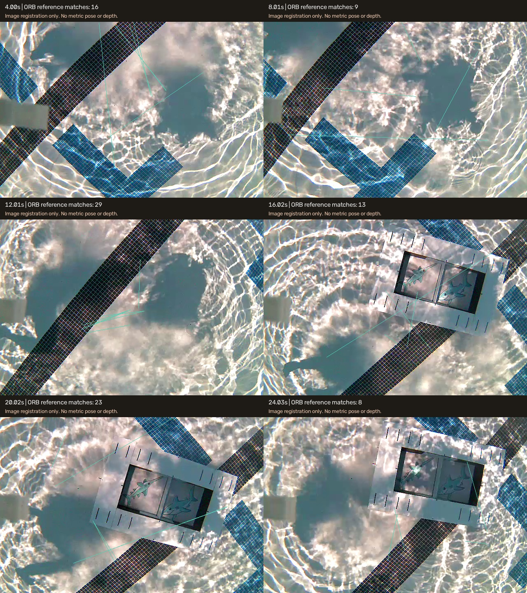
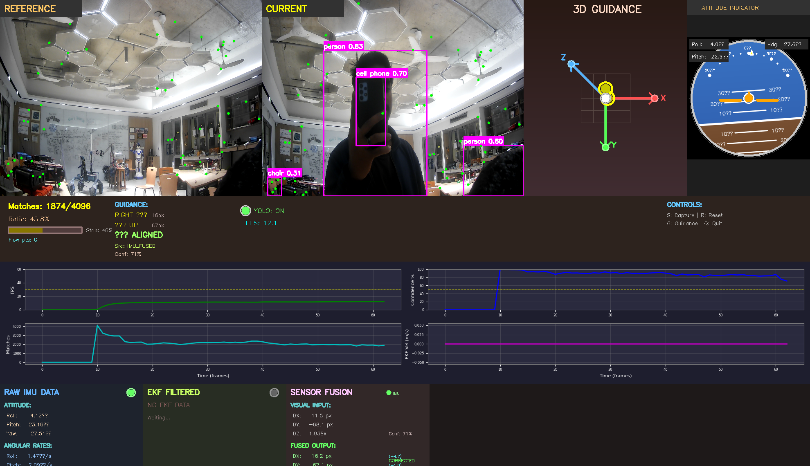

# ধ্রুবতারা · Dhrubotara

**A reference in the image is not a position in the world.**

Dhrubotara means the North Star: a directional reference, not a complete navigation solution. The name fits this experiment more closely than calling every arrow in its interface a pose estimate.

This grows out of my visual-guidance work: XFeat matches against a captured reference, YOLO detections, an optical-flow fallback, Pixhawk telemetry and a dashboard that tried to bring them together. The preserved source has the numbered attempts as well as the later modular application. This repository keeps that history, then takes one question out of the display and makes it reproducible:

> When image structure moves, which of the displayed numbers are actually measurements—and which are heuristics?



*New CPU replay of the supplied pool recording. These lines come from ORB correspondences, not XFeat inference. They connect current-frame points to reference-frame image coordinates; they are not vehicle trajectories. The input contains tiled structure, a target and moving illumination. There is no ground-truth camera pose.*

## Two experiments, kept separate

1. **Controlled image translations.** Seeded texture is shifted by known pixel offsets without being resized. The original guidance kernels run on those image pairs. This supplies exact image-space truth, not a simulated physical vehicle trial.
2. **Recorded-input replay.** The full supplied pool clip is decoded and sampled every five frames. ORB supplies a small, CPU-only correspondence baseline to the original homography-guidance function. The original Lucas–Kanade fallback runs independently between consecutive sampled frames.

The replay does not restore the historical XFeat/YOLO application, and it does not turn the footage into a navigation benchmark. It isolates numerical code that was previously surrounded by a much larger live application.

## The result that matters

The archived optical-flow function computes median displacement, then defines its third output as:

```python
scale = 1.0 if median_flow <= 2.0 else 1.0 + (median_flow - 2.0) / 50.0
```

That output grows whenever the tracked image points move far enough—even if the entire image only slides sideways. In the controlled experiment, the image scale is exactly one throughout:

| Known horizontal shift | Homography scale | Archived flow “scale” | Archived flow score |
| ---: | ---: | ---: | ---: |
| 0 px | 1.000 | 1.000 | 100.00% |
| 5 px | 1.000 | 1.060 | 99.69% |
| 10 px | 1.000 | 1.160 | 99.37% |
| 20 px | 1.000 | 1.360 | 95.76% |

Values above are from [`results/controlled.json`](results/controlled.json), rounded for reading. The ten-pixel case has almost the maximum displayed score while its “scale” changes despite no image expansion. The score rewards feature count and consistency of motion; it is not a calibrated probability that depth changed.

The useful correction is a boundary of interpretation: **do not call this quantity depth**. It remains in the archived kernel unchanged so the result can be reproduced, rather than quietly repairing the baseline and losing the reason for this investigation.

## What the reference matcher estimates

The historical function fits a homography from current points back to reference points:

$$
\mathbf{x}_{ref} \sim H\mathbf{x}_{current}.
$$

It uses RANSAC with a five-pixel reprojection threshold, requires at least eight proposed matches, reports the fraction accepted as inliers, and extracts `H[0, 2]`, `H[1, 2]` and the mean norm of the first two matrix columns.

For a pure image translation this is easy to interpret: a scene shifted ten pixels right requires a mapping ten pixels left to align it to the reference. For a general projective transformation, the two translation entries are not a world-space displacement or even a spatially constant image displacement. Rotation, perspective, camera intrinsics and the observed surface matter.

A planar scene viewed by calibrated cameras admits a homography related to rotation, translation and plane geometry, commonly written under a chosen frame convention as:

$$
H \sim K(R + t n^T/d)K^{-1}.
$$

The translation term is coupled to plane distance. Without the missing calibration and scale information, fitting a matrix to image correspondences does not independently recover a metric translation. Under pure rotation, a homography can also fit scene points without describing a translating plane.

The replay therefore records the original matrix-derived values in **pixels and dimensionless scale**. It does not convert them to metres, velocity or a six-degree-of-freedom vehicle state.

## What the flow fallback estimates

Lucas–Kanade tracks local image patches under assumptions about brightness and nearby motion. The preserved function:

- detects up to 200 corners;
- uses a 21×21 tracking window and an image pyramid;
- retains points whose forward tracking status is valid;
- takes median horizontal and vertical displacement;
- negates those displacements for its guidance convention;
- constructs a score from surviving point count and the spread of flow magnitudes.

It does not perform a forward–backward consistency check, segment moving objects, compensate refraction or establish an inertial frame. A textureless controlled frame correctly produces an invalid result with zero score. A textured frame can produce a valid result for reasons unrelated to camera translation.

The pool recording makes the brightness assumption worth examining: bright patterns move over the tiled floor. That is a visible condition in the supplied footage, not a measured attribution of each correspondence error to caustics. With no pose ground truth, this repository cannot quantify how much vehicle-motion error that condition caused.

## Recorded-input result

The committed run used the complete 640×480 input, approximately 30 seconds at 29.9644 frames/s. Sampling every five frames produced **179 evaluated pairs**:

- the original homography-guidance function returned a valid fit on **144 pairs**;
- the original optical-flow fallback returned valid on **179 pairs**.

“Valid” is each function's own return flag. **144/179 is not a navigation accuracy score, and 179/179 is not proof of correct tracking.** The fixed-reference matcher and previous-frame optical flow also have different baselines: their displacements must not be treated as estimates over the same time interval.

The full per-pair record is in [`frames.csv`](results/pool-every-5/frames.csv); input identity, sample policy and counts are in [`summary.json`](results/pool-every-5/summary.json). ORB and RANSAC results can vary with OpenCV versions. The controlled translation result is the stronger causal evidence here.

## The interface this came from



*Historical capture named 23 November 2025. Reference/current images, detections, guidance, an attitude display and performance traces share a window. The EKF panel in this particular image says no EKF data. Displayed values are not independently validated measurements.*

The reference interaction is visible in the source: `S` captures a frame, `R` resets, and `G` toggles guidance. A frozen image is a useful thing to return to. It is also a tempting place to hide a change of meaning: a pixel correction becomes an axis arrow, a dimensionless ratio becomes a depth label, and a consistency score begins to look like certainty.

The preserved IMU fusion code adds another unresolved boundary. It applies a simplified roll correction and, when EKF data is fresh, scales velocity components by a hard-coded factor of 100 before blending them with image displacement. That is not a calibrated camera-to-inertial projection. The offline replay deliberately does not exercise that path, synthesize telemetry or claim that fusion was validated by a screenshot.

## Run it

Python 3.11 or newer; CPU only. No model downloads, GPU, camera, serial port or autopilot are required.

```bash
python -m venv .venv
.venv/bin/python -m pip install -e .

# Exact image-space translation experiment.
.venv/bin/python -m dhrubotara.experiment

# Supplied recording, included unchanged.
.venv/bin/python -m dhrubotara \
  --video data/heading-down.mp4 \
  --every 5 \
  --output results/pool-every-5

.venv/bin/python -m unittest discover -s tests
```

`--video` must name an existing file. Numeric camera indices and network streams are not accepted. `--max-frames` can bound a shorter run; `--every` changes the temporal baseline and must be recorded when comparing outputs. The CSV leaves failed estimates empty rather than filling them with a plausible zero pose.

The supported replay entry point does **not** import the historical application. Do not run `origin/` indiscriminately: some original scripts open cameras, search for telemetry devices or send MAVLink commands, including a reboot command in `pix_control_v2.py`.

## Repository map

```text
dhrubotara/             file-only replay, controlled experiment, archived kernels
data/heading-down.mp4  supplied pool recording; bytes unchanged
media/                 historical application capture
results/               measured JSON, CSV and the replay contact sheet
tests/                 geometric and missing-observation boundaries
origin/                39 supplied Python files and the original web frontend
provenance.json        original relative paths and SHA-256 identities
```

Publication exception: the historical backend's hard-coded Flask signing key is not redistributed. Its publication copy requires `VISUAL_NAV_SECRET_KEY` from the environment. The original file remains untouched in the supplied archive, and `provenance.json` records both original and publication-copy hashes. Other source snapshots and the two numerical kernel bodies are unchanged. The historical dashboard is not a supported deployment entry point.

`baseline.py` mechanically carries over the two numerical functions from the archived modular application. It removes their dependency on Torch preprocessing and live adapters without changing their bodies. The original complete modules remain in `origin/visual_nav_sys/subsystems/`.

The source history also contains vanishing-point and heading experiments, control helpers, feature-matching versions and both native/web dashboard code. Preserving them does not assert that every version ran, that their numbering is chronological, or that each feature reached a deployed vehicle. This repository's executable research claim is the bounded image-guidance investigation above.

## Attribution and boundaries

Application/integration sources and media were supplied from Fahim Faisal's work archive. Upstream models and algorithms remain upstream work. In particular, XFeat is by the [Verlab accelerated_features project](https://github.com/verlab/accelerated_features), not an algorithm authored for this repository. The supplied XFeat checkout matches commit `e92685f57f8318b18725c5c8c0bd28c7fe188d9a` in tracked content and carries Apache-2.0; that vendor tree and its weights are not redistributed here. The historical applications also refer to Ultralytics YOLO and other dependencies; the supported CPU experiment does not bundle or import them.

The pool input was supplied with the archive; it is not a newly filmed test. No recording date, camera calibration, physical trajectory or individual recording credit has been inferred from its filename. The historical capture and the new replay are separate evidence. No blanket redistribution license has been applied to the historical snapshots.

## Further reading

- [OpenCV: Feature Matching + Homography](https://docs.opencv.org/4.x/d1/de0/tutorial_py_feature_homography.html): correspondences, RANSAC and the inlier mask.
- [OpenCV: Optical Flow](https://docs.opencv.org/4.x/d4/dee/tutorial_optical_flow.html): brightness constancy, the aperture problem, pyramidal Lucas–Kanade and forward–backward checking.
- [XFeat source and project references](https://github.com/verlab/accelerated_features): the learned matcher used by the historical application; not the feature backend of this replay.

The next engineering decision is not which arrow looks smoother. It is which observation, frame, unit and time interval each arrow is allowed to stand for.
